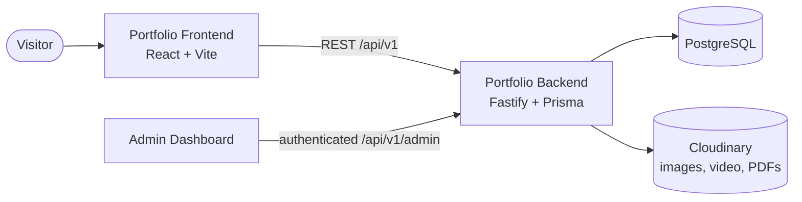

<div align="center">

# Portfolio Frontend

**The public-facing portfolio website of Elango Sugikaran**, a fast, responsive single-page app whose content is managed from a private admin dashboard.

[](https://sugikaran-dev.netlify.app/)


</div>

---

## Overview

This is the visitor-facing part of my portfolio platform. Nothing on the site is hard-coded: projects, skills, experience, education, certificates, CV and site settings are all loaded from the [Portfolio Backend](https://github.com/ElangoSugikaran/portfoilio-backend) API and edited through the [Admin Dashboard](https://github.com/ElangoSugikaran/admin-dashboard-frontend), so I can update the site without redeploying.

## Features

- **Single-page home** with Hero, About, Experience, Projects, Skills, Education, Certifications and Contact sections
- **Dedicated pages** for all projects, project details (with media gallery), education and certifications by category
- **Contact form** that sends messages through the backend
- **CV download** served from the API
- **Dark / light / system theme**, remembered between visits
- **Smooth motion** using GSAP, Framer Motion and Lenis smooth scrolling
- **SEO and analytics ready**: per-page meta tags, `sitemap.xml`, `robots.txt` and optional Google Analytics 4
- **Safe rich text**: project content is sanitised with DOMPurify before rendering
- **Resilient UI**: loading skeletons, error fallbacks and a 404 page

## Tech Stack

| Area | Tools |
|---|---|
| Framework | React 19, TypeScript, Vite, React Compiler |
| Styling and UI | Tailwind CSS 4, shadcn/ui, Base UI, Lucide icons |
| Data | TanStack Query, Axios |
| State | Zustand (theme) |
| Routing | React Router 7 |
| Animation | GSAP, Framer Motion, Lenis |
| Quality | ESLint, Husky and lint-staged (lint on commit) |

## Architecture



Data fetching follows one pattern: **service** (Axios call) → **hook** (TanStack Query) → **section or page** (UI).

## Getting Started

**Prerequisites:** Node.js 20.19+ (22 LTS recommended) and a running [backend](https://github.com/ElangoSugikaran/portfoilio-backend).

```bash
# 1. Install dependencies
npm install

# 2. Configure environment
cp .env.example .env

# 3. Start the dev server (http://localhost:5174)
npm run dev
```

### Environment variables

| Variable | Required | Description |
|---|---|---|
| `VITE_API_URL` | Yes | Backend base URL, e.g. `http://localhost:8000/api/v1` |
| `VITE_GA_MEASUREMENT_ID` | No | Google Analytics 4 ID (e.g. `G-XXXXXXXXXX`) |

> The backend must list this app's origin (`http://localhost:5174` locally) in its `CORS_ORIGINS`.

### Scripts

| Command | Description |
|---|---|
| `npm run dev` | Start the development server on port 5174 |
| `npm run build` | Type-check and create a production build in `dist/` |
| `npm run preview` | Preview the production build locally |
| `npm run lint` | Run ESLint |

## Project Structure

```text
src/
├── sections/     # Home page sections (Hero, About, Experience, ...)
├── pages/        # Route pages (Projects, ProjectDetail, Education, ...)
├── components/   # Shared UI, layout and common components
├── hooks/api/    # TanStack Query hooks, one per resource
├── services/     # Axios API client and per-resource services
├── store/        # Zustand stores (theme)
├── lib/          # Utilities: analytics, SEO, query keys, constants
├── routes/       # React Router configuration
└── types/        # Shared TypeScript types
```

## Related Repositories

| Repo | Purpose |
|---|---|
| [portfoilio-backend](https://github.com/ElangoSugikaran/portfoilio-backend) | REST API, database and file storage |
| [admin-dashboard-frontend](https://github.com/ElangoSugikaran/admin-dashboard-frontend) | Private dashboard to manage all content |

## Author

**Elango Sugikaran**, Full Stack Software Engineer
[Portfolio](https://sugikaran-dev.netlify.app/) · [LinkedIn](https://www.linkedin.com/in/elango-sugikaran-75323a256/) · [GitHub](https://github.com/ElangoSugikaran)
